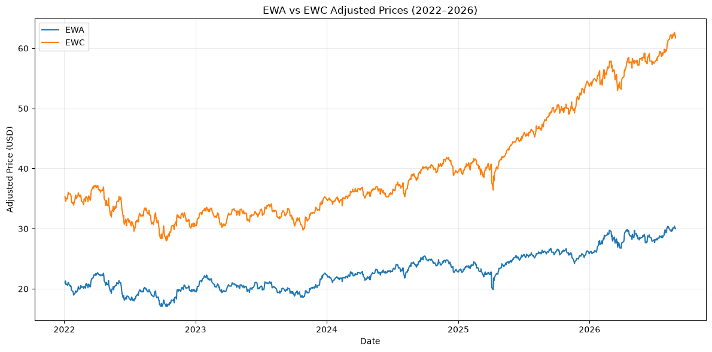
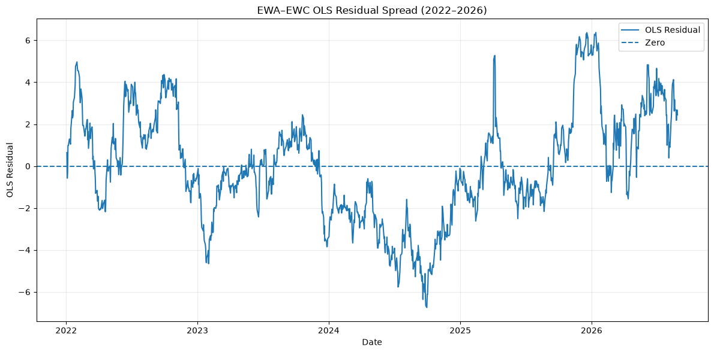

# Revisiting EWA–EWC Cointegration

## Overview

This project investigates whether the historically documented cointegration relationship between the Australian and Canadian equity markets has persisted in recent years.

The analysis focuses on:

- **EWA** — iShares MSCI Australia ETF
- **EWC** — iShares MSCI Canada ETF

The EWA–EWC pair has previously been used as an example of cointegration in Ernest P. Chan's *Algorithmic Trading*. Rather than assuming that this historical relationship remains stable, this project revisits the pair using daily adjusted prices from **2022 to 2026**.

The main research question is:

> **Does the historical EWA–EWC cointegration relationship still hold in the recent market regime?**

---

## Economic Motivation

Australia and Canada share several macroeconomic characteristics, including meaningful exposure to commodities, natural resources, and resource-related industries.

This provides an economic rationale for investigating whether their equity markets share a stable long-run relationship.

Importantly, the pair was selected based on economic intuition and prior empirical evidence rather than by searching a large universe of securities for statistically significant pairs.

---

## Data

Daily adjusted price data for EWA and EWC were obtained using Yahoo Finance through the `yfinance` Python library.

**Sample period:** January 2022 – August 2026

The analysis was conducted using:

- Python
- pandas
- NumPy
- matplotlib
- statsmodels
- yfinance

---

## Price Relationship

The figure below shows the adjusted prices of EWA and EWC during the sample period.



Visual co-movement can motivate further investigation, but it does not by itself establish cointegration.

---

## Methodology

### 1. OLS Regression

Following the Engle–Granger framework, the long-run relationship is first estimated as:

\[
EWC_t = \alpha + \beta EWA_t + \epsilon_t
\]

The estimated model produces approximately:

- **Intercept:** -22.57
- **Hedge ratio:** 2.73
- **R²:** 0.92

A high R² indicates strong in-sample co-movement, but does not establish cointegration because regressions between non-stationary time series can be spurious.

### 2. Residual Spread

Using the estimated relationship, the residual spread is constructed as:

\[
\epsilon_t = EWC_t - \alpha - \beta EWA_t
\]



The residual exhibits repeated movements around its long-run level, but also persistent deviations. Formal statistical testing is therefore required to determine whether the residual is stationary.

### 3. Engle–Granger Cointegration Test

The null hypothesis is that EWA and EWC are **not cointegrated**.

For the EWC-on-EWA specification:

| Statistic | Value |
|---|---:|
| Test statistic | -2.896 |
| p-value | 0.137 |
| 5% critical value | -3.341 |

The null hypothesis cannot be rejected at the 5% significance level.

Because the Engle–Granger procedure is asymmetric, the regression direction was also reversed.

For the EWA-on-EWC specification:

| Statistic | Value |
|---|---:|
| Test statistic | -3.206 |
| p-value | 0.069 |
| 5% critical value | -3.341 |
| 10% critical value | -3.048 |

The result remains insignificant at the pre-specified 5% level, although it provides weaker evidence of cointegration at the 10% level.

### 4. Johansen Cointegration Test

The Johansen test was used as a system-based robustness check.

| Test | Statistic | 5% Critical Value | 10% Critical Value |
|---|---:|---:|---:|
| Trace, r = 0 | 14.380 | 15.494 | 13.429 |
| Maximum Eigenvalue, r = 0 | 12.734 | 14.264 | 12.297 |

Neither statistic rejects the null of zero cointegrating relationships at the 5% level.

Both statistics, however, exceed their respective 10% critical values.

---

## Results

| Test | 5% Result | 10% Result |
|---|---|---|
| Engle–Granger: EWC ~ EWA | Fail to reject | Fail to reject |
| Engle–Granger: EWA ~ EWC | Fail to reject | Reject |
| Johansen Trace | Fail to reject | Reject |
| Johansen Maximum Eigenvalue | Fail to reject | Reject |

At the pre-specified **5% significance level**, the recent sample does not provide sufficient evidence to reject the null hypothesis of no cointegration.

However, the reverse Engle–Granger specification and both Johansen statistics provide weaker evidence of cointegration at the 10% level.

---

## Conclusion

The historical EWA–EWC relationship appears weaker in the 2022–2026 sample than in the historical example that motivated this study.

Despite strong price co-movement and an OLS R² of approximately 0.92, the relationship does not satisfy the pre-specified 5% cointegration criterion.

For this reason, the research process stops at the statistical validation stage rather than proceeding directly to the construction and backtesting of a mean-reversion strategy.

This exercise highlights several important lessons:

- Correlation and high R² do not imply cointegration.
- Cointegration relationships can change across market regimes.
- Engle–Granger results can be sensitive to regression direction.
- Johansen testing provides a system-based alternative to the two-step Engle–Granger approach.
- Statistical thresholds should be defined before observing the results rather than relaxed afterward to support a desired conclusion.

A negative or inconclusive statistical result can still be useful: rejecting a trading hypothesis before strategy development helps reduce unnecessary backtesting and data mining.

---

## Limitations and Further Research

The analysis is limited to the 2022–2026 sample and assumes a stable relationship over the entire period.

Potential extensions include:

- rolling-window cointegration analysis,
- structural-break testing,
- formal lag-order selection for the Johansen model,
- alternative deterministic specifications,
- time-varying hedge ratios.

A trading strategy was intentionally not backtested because the pair did not satisfy the project's pre-specified 5% cointegration criterion.

---

## Repository Structure

```text
ewa-ewc-cointegration/
│
├── README.md
├── ewa_ewc_research.ipynb
├── requirements.txt
│
└── figures/
    ├── ewa_ewc_prices.png
    └── ewa_ewc_residual.png
```

---

## Reference

Ernest P. Chan, *Algorithmic Trading: Winning Strategies and Their Rationale*, Wiley.

---

## Disclaimer

This project is for educational and research purposes only and does not constitute investment advice.